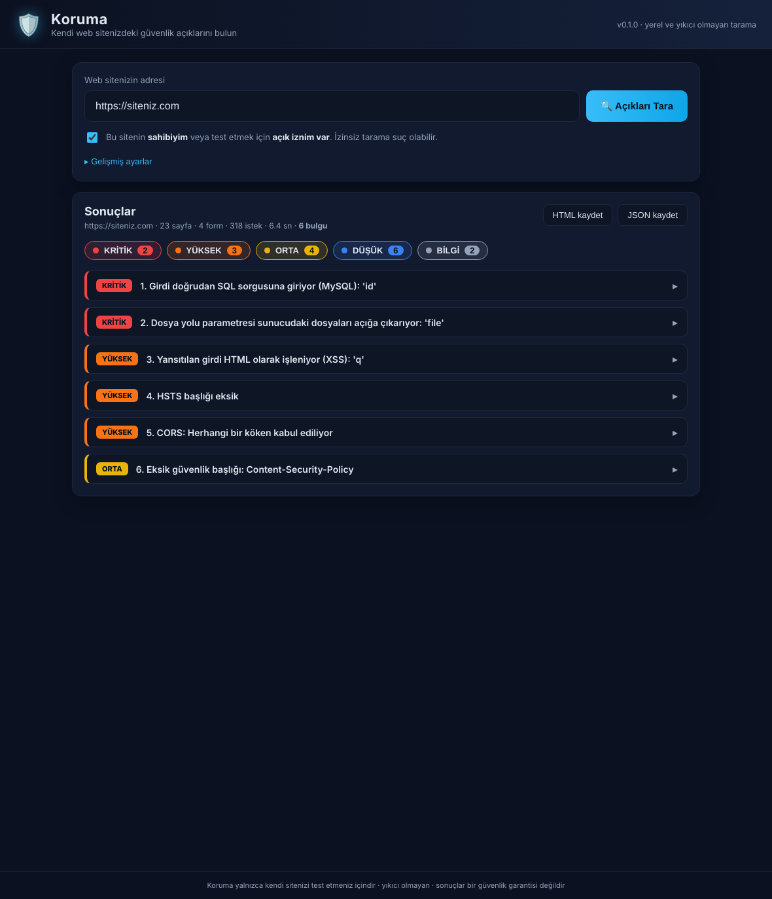

# Koruma 🛡️

**Kendi web sitenizdeki** yaygın güvenlik açıklarını bulan, yıkıcı olmayan (non-destructive) bir tarama aracı.

Koruma sitenizi gezer (crawl eder), formları ve bağlantıları keşfeder ve bir dizi
güvenlik kontrolü uygular. Çıktı; her bulgu için **sorunu**, **neden önemli
olduğunu** ve **nasıl düzeltileceğini** açıklayan Türkçe bir rapordur.

> ⚠️ **Yalnızca sahibi olduğunuz ya da test etmek için açık izniniz olan siteleri tarayın.**
> İzinsiz güvenlik taraması birçok ülkede suçtur. Araç her çalıştığında bunu onaylatır.

## Neleri kontrol eder?

| Kontrol | Aradığı şeyler |
|---|---|
| `headers` | Eksik güvenlik başlıkları (CSP, X-Frame-Options, …), zayıf CSP, sürüm sızıntısı |
| `tls` | HTTPS yok, HTTP→HTTPS yönlendirmesi, HSTS, sertifika süresi, eski TLS 1.0/1.1 |
| `cookies` | `Secure`, `HttpOnly`, `SameSite` bayrakları eksik çerezler |
| `files` | Açıkta kalan `.git`, `.env`, yedekler, veritabanı dökümleri, dizin listeleme, `phpinfo` vb. |
| `cors` | Aşırı gevşek CORS (origin yansıtma, `null`, credentials ile `*`) |
| `methods` | Riskli HTTP metotları, etkin `TRACE` |
| `disclosure` | Sayfalarda sızan API anahtarları, yığın izleri (stack trace), iç IP'ler, riskli HTML yorumları, karışık içerik |
| `injection` | Yansıtılan XSS, hata tabanlı SQL enjeksiyonu, şablon enjeksiyonu (SSTI), dizin geçişi (path traversal), eksik CSRF token'ı |
| `redirect` | Açık yönlendirme (open redirect) |
| `fingerprint` | Sunucu/çerçeve/CMS tespiti ve sürüm ifşası (OWASP A06 bağlamı) |
| `components` | **Bilinen CVE'li JavaScript kütüphaneleri** (16 kütüphane, 50+ CVE: jQuery, jQuery-UI, Bootstrap, lodash, AngularJS, Vue, React, Moment, Handlebars, DOMPurify, axios, Underscore, CKEditor 4/5, bootstrap-select, flowplayer) + çapraz kökenli scriptlerde SRI eksikliği. İsteğe bağlı `--online` ile OSV.dev doğrulaması. |
| `endpoints` | GraphQL introspection, yönetim/API panelleri, çapraz alan politikaları (crossdomain.xml), WordPress kullanıcı sayımı (REST API, `?author=`, xmlrpc.php) |
| `advanced` | CRLF enjeksiyonu / HTTP yanıt bölme, Host başlığı enjeksiyonu, hassas sayfalarda önbellekleme politikası |
| `dns_email` | SPF, DMARC, DKIM, CAA, DNSSEC kayıtları (e-posta sahteciliği ve sertifika yanlış verilmesine karşı koruma) |
| `access` | **Bozuk erişim kontrolü (OWASP A01)**: forced browsing (korunmasız yönetim sayfaları), sıralı kimlik numaralandırma (**olası IDOR**), kimlik doğrulamalı vs doğrulamasız yanıt karşılaştırması |
| `baas` | **Backend-as-a-Service yanlış yapılandırması** (modern yüksek-etkili açıklar): **Supabase** istemciye sızmış `service_role`/`sb_secret` anahtarı, **RLS kapalı tablolardan anon anahtarıyla veri okunması** (Supabase "rls_disabled_in_public" uyarısı), **Firebase** herkese açık Realtime Database, herkese listelenebilir **S3/GCS bucket**'ları |
| `jsrecon` | **Derin JavaScript keşfi** (bug bounty avcılarının yöntemi): aynı kökenli JS dosyalarını indirip içlerinde gömülü **sır/anahtar**, **kaynak haritası (.js.map) ifşası** (kaynak kod sızıntısı), **gizli/riskli uç noktalar** (admin/debug/internal API), iç ağ adresleri |

### Ek özellikler

- **PDF / HTML / JSON rapor** — `--format pdf -o rapor.pdf` (veya arayüzde "PDF kaydet").
- **Periyodik tarama** — `--repeat 3600` her saat yeniden tarar; arayüzde "Otomatik tekrar".
- **Kimlik doğrulamalı tarama** — `--cookie "session=..."` veya `--header "Authorization: Bearer ..."`
  ile giriş yapılmış alanları ve erişim kontrolünü test eder.
- **CVE veritabanı güncelleme** — `koruma --update-db` Retire.js'ten güncel zafiyet verisini
  çeker (16 küratörlü → 70+ kütüphane, 500+ CVE'ye genişler). Arayüzde "CVE veritabanını güncelle".

### OWASP Top 10 kapsamı

Koruma, [OWASP Top 10 (2021)](https://owasp.org/Top10/) risk kategorilerinin
büyük bölümünü hedefler:

- **A01 Broken Access Control** — dizin listeleme, açık dosyalar, HTTP metotları
- **A02 Cryptographic Failures** — HTTPS/TLS, HSTS, sertifika, çerez bayrakları
- **A03 Injection** — XSS, SQLi, SSTI, dizin geçişi
- **A05 Security Misconfiguration** — güvenlik başlıkları, CORS, hata ifşası, phpinfo vb.
- **A06 Vulnerable & Outdated Components** — `components` + `fingerprint` (CVE eşleşmeli)
- **A07 Identification & Auth Failures** — CSRF token eksikliği, çerez güvenliği
- **A08 Software & Data Integrity** — SRI eksikliği (tedarik zinciri)
- **A09/A10** — bilgi sızıntısı ve güvenli olmayan yönlendirmeler için sınırlı sinyaller

> Güvenlik açığı verisi, [Retire.js](https://github.com/RetireJS/retire.js) ve
> [OSV.dev](https://osv.dev/) veritabanlarından türetilmiş, elle doğrulanmış bir
> CVE alt kümesidir. Çevrimdışı çalışır; `--online` ile canlı OSV sorgusu eklenir.

### GitHub güvenlik repolarından entegre edilen bilgi tabanları

Koruma, önde gelen açık kaynak güvenlik projelerinin tekniklerini içerir:

- **Sır tespiti** — [gitleaks](https://github.com/gitleaks/gitleaks) kural
  setinden türetilmiş 31 yüksek-güvenli desen (AWS, GCP, Azure, Stripe, GitHub,
  GitLab, Slack, Twilio, SendGrid, Mailgun, OpenAI, Anthropic, özel anahtarlar,
  JWT…). `disclosure` ve `jsrecon` bu merkezi tarayıcıyı (`koruma/secrets.py`)
  paylaşır.
- **İçerik keşfi** — [SecLists](https://github.com/danielmiessler/SecLists)
  quickhits listesinden türetilmiş yüksek-sinyalli hassas dosya/dizin yolları
  (SSH anahtarları, `.npmrc`/`.netrc`, CI/CD yapılandırmaları, actuator/jolokia,
  framework config/yedekleri). `files` kontrolü soft-404 filtresiyle dener.
- **Bileşen CVE'leri** — [Retire.js](https://github.com/RetireJS/retire.js)
  (`--update-db` ile canlı senkron).

Tüm testler **yıkıcı değildir**: hiçbir veriyi silmez/değiştirmez, yalnızca
sunucunun yanıtını okur. Varsayılan olarak `logout`, `delete`, `sil` gibi
bağlantılara girilmez ve POST formları yalnızca `--test-post-forms` ile test edilir.

## 🖥️ Masaüstü uygulaması (Electron + React)

Komut satırını kullanmak istemiyorsanız, `desktop/` klasöründe tam bir
**Windows/Linux masaüstü uygulaması** vardır: bir kutuya sitenizin adresini
yazıp **Açıkları Tara** düğmesine basmanız yeterli. Kurulum, çalıştırma ve
`.exe` paketleme için bkz. [`desktop/README.md`](desktop/README.md).



## Kurulum

```bash
git clone <depo-adresi>
cd Koruma
pip install -e .
# veya sadece bağımlılıklar:
pip install -r requirements.txt
```

## Kullanım

```bash
# En basit hali (onay sorar)
koruma https://siteniz.com

# veya paket olarak
python -m koruma https://siteniz.com

# HTML rapor dosyasına yaz
koruma https://siteniz.com --format html -o rapor.html

# Sadece belirli kontroller
koruma https://siteniz.com --checks headers,tls,cookies

# Giriş yapılmış alanları tara (oturum çerezi vererek)
koruma https://siteniz.com --cookie "session=abc123"

# CI için: ORTA ve üzeri bulgu varsa çıkış kodu 2
koruma https://siteniz.com -y -q --fail-on medium
```

### Önemli seçenekler

| Seçenek | Açıklama |
|---|---|
| `--checks` | Çalıştırılacak kontroller (virgülle) |
| `--max-pages N` | Azami taranacak sayfa (vars. 50) |
| `--delay S` | İstekler arası bekleme (vars. 0.2 sn) — sunucuyu yormamak için |
| `--format text\|json\|html` | Rapor biçimi |
| `-o DOSYA` | Raporu dosyaya yaz |
| `--header "Ad: Değer"` | Ek istek başlığı (örn. `Authorization`) |
| `--cookie "ad=değer"` | Oturum çerezi |
| `--test-post-forms` | POST formlarını da test et (dikkat: yan etkisi olabilir) |
| `--insecure` | TLS doğrulamasını atla |
| `--fail-on SEVIYE` | CI için çıkış kodu (`low`…`critical`) |
| `-y` | Yetki onayını otomatik kabul et |
| `-q` | Sessiz mod |

## Çıkış kodları

- `0` — başarı (ya da `--fail-on` eşiğinin altında bulgular)
- `1` — kullanım/girdi hatası veya onay verilmedi
- `2` — `--fail-on` eşiği veya üzerinde en az bir bulgu

## Geliştirme ve test

```bash
pip install -e ".[dev]"
pytest
```

Testler, `tests/vulnerable_app.py` içindeki kasıtlı olarak açık içeren küçük
bir yerel uygulamaya karşı tüm kontrolleri doğrular. Bu uygulamayı gerçek bir
ortamda çalıştırmayın.

Yeni kontrol eklemek için `koruma/checks/` altına bir modül ekleyip içinde
`NAME` ve `run(ctx) -> list[Finding]` tanımlayın, sonra
`koruma/checks/__init__.py` içindeki `ALL_CHECKS`'e kaydedin.

## Sorumluluk reddi

Koruma bir yardımcı araçtır; **güvenlik garantisi değildir**. Hiçbir otomatik
tarayıcı tüm açıkları bulamaz. Önemli sistemler için profesyonel bir sızma testi
(penetration test) yaptırın.

## Lisans

MIT
